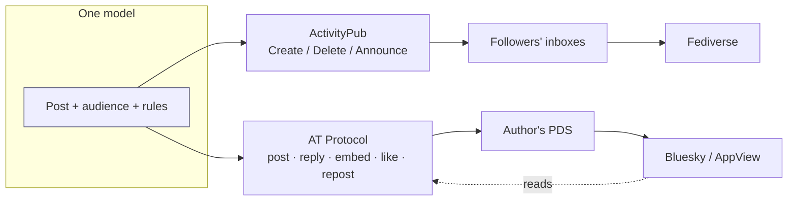

# Aloha Social Core

The host-neutral core of Aloha Social: domain, federation, services, HTTP
contract and platform ports.

> **This repository is a library.** It has no installable server, login page
> or process of its own. It is the shared foundation that the Aloha Social
> hosts run. The Nextcloud app, the standalone server and their bridges live in
> separate repositories.

The architecture and the boundary between the core and its hosts are described
in [ADR 0001](docs/adr/0001-shared-core-two-hosts.md) and
[the architecture document](docs/architecture.md).

## Two protocols, one local model

Aloha Social keeps one local post, one audience and one set of rules, and
translates that model to two wire protocols. It does **not** define a third
protocol: ActivityPub and AT Protocol remain the protocols peers speak.



| Capability | ActivityPub | AT Protocol | Status |
| --- | --- | --- | --- |
| Public text post | `Create(Note)` | `app.bsky.feed.post` | both |
| Delete | `Delete` | `deleteRecord` | both |
| Follow | `Follow` / `Accept` | `app.bsky.graph.follow` | ActivityPub |
| Boost | `Announce` | `app.bsky.feed.repost` | both (core writes the record) |
| Like | `Like` | `app.bsky.feed.like` | local + core record |
| Media | attachment + public URL | blob upload + `images`/`video` embed | core |
| Reply | `in_reply_to` | strong-ref reply | core |
| Profile | actor document | `app.bsky.actor.profile` | core |

The AT Protocol write/read library covers posts, facets, replies, media, likes,
reposts, profile, an AppView timeline read, and replay-safe inbound import of
relay/Jetstream/AppView pages. The follow record is not written, and the host
still drives the transport — linking, credentials, PDS choice and the UI; the
[server blueprint](docs/guides/server-architecture.md) covers that part.

"Both" means one local post can be delivered to ActivityPub followers and
mirrored to the author's PDS at the same time, with independent failures. The
core does not merge identities, timelines or engagement across the networks.
The full mapping, guarantees and the path to a real bridge are in
[two protocols, one model](docs/guides/dual-protocol.md) and
[ADR 0007](docs/adr/0007-two-protocols-one-model.md).

## What is implemented

| Area | Implemented here |
| --- | --- |
| Posts and timelines | create, read, edit and soft-delete local posts, with author-only edits, revision history and ActivityPub `Update` delivery; replies with `in_reply_to_id`; direct posts with local recipients; public, home, hashtag and followed-hashtag timelines; cursor pagination; post visibility, including followers-only reads by accepted local followers; post attachments |
| Social interactions | local favourites, private bookmarks, local mutes, private account lists, private followed hashtags and notifications with dismiss/unread state; polls with local voting and imported remote Questions; quote posts with FEP-044f QuoteRequest/QuoteAuthorization, revocation and a null preview for withdrawn or private targets; per-user blocks with outbound ActivityPub `Block`/`Undo(Block)`; federated `Like`/`EmojiReact` in both directions and outbound remote `Announce`/`Undo(Announce)` boosts, with separate counts and idempotent delivery; local follow/unfollow and relationship reads |
| Follow graph | incoming and outgoing edges with persistent `pending`/`accepted`/`rejected` state, locked-account requests with owner accept/reject and signed answers, retried queued Follow/Undo delivery, verified Accept/Reject, individual and shared inboxes, batched delivery, optional follow policy, local-to-local follows and local-follow home timeline; signed ActivityPub `Move` with reciprocal `alsoKnownAs` checks and resumable follower portability |
| Federation | HTTP signatures, host-fed actor profiles with display name, bio, avatar/header, verified `rel=me` fields, locked follows and owner-only hidden member pages, WebFinger, followers/following/outbox collections, shared inboxes, signed delivery, retries and dead letters; inbound `Follow`/`Move`/`Accept`/`Reject`/`Undo`/`Create`/`Update`/`Delete`/`Announce`/`Add(Story)`, `Like`/`Undo(Like)` and `EmojiReact`/`Undo(EmojiReact)`; outbound `Follow`/`Undo(Follow)`, `Block`/`Undo(Block)`, `Like`/`Undo(Like)`, `EmojiReact`/`Undo(EmojiReact)`, local and remote `Announce`/`Undo(Announce)`, `Update` for edits and `Update(Person)` for profile changes |
| Remote content | remote posts and boosts, follow-based home timeline, per-user block filtering, guarded remote media, outbox backfill and bounded thread/context fetching |
| Media | image validation, originals and GD thumbnails, local upload/fetch/update/delete, attachments in posts and timelines, guarded remote-media ingestion |
| AT Protocol | account/record primitives, deterministic TIDs, bearer or DPoP-bound XRPC `putRecord`/`deleteRecord`, byte-offset tag/mention/link facets, reply references with a `getRecord` CID lookup, image/video blob uploads with `app.bsky.embed.images`/`#video` embeds, likes and reposts as `app.bsky.feed.like`/`#.repost` records, the `app.bsky.actor.profile` record, an AppView timeline read port, replay-safe inbound relay/Jetstream/AppView import with cursors, tombstones and cached feeds, idempotent publication rows, a readable publication state, remote delete, OAuth session refresh and the authorization-code/PAR/revocation protocol client; an optional native PDS with `did:plc`/PLC key lifecycle and directory publication, a durable MST/commit store, `createRecord`/`getRecord`/`listRecords`/`listMissingBlobs`/`describeRepo`/`sync.getRepo` (full or `since` diff), a WebSocket firehose, CAR import/blocks and signed key rotation |
| Mastodon compatibility | optional, disabled-by-default subset under the configurable prefix: instance metadata/statistics, public timeline, status read/create/edit/delete (including direct statuses and replies), reblogs, status context, poll creation/voting, favourites, private bookmarks, local mutes, private account lists with list timelines and the exclusive home filter, local follow/unfollow and relationships, notifications (including mentions and reblogs) with dismiss/unread state, local search, media upload/update/delete, account profiles, follower/following lists, account statuses and verify credentials |
| HTTP | request/response, parameterised router, middleware, kernel, one JSON error shape, route manifest and OpenAPI export (239 routes; 56 under the compatibility prefix) |
| Persistence | in-memory and PDO repositories behind shared contract tests; durable `PdoJobQueue` and `PdoActivityLog`; schema classes for every core table; `TransactionRunner` for atomic multi-repository writes |
| Operations | core `cleanup` worker job and service for unreferenced media older than a retention window, read notifications and thread caches; dry run, per-kind limits, idempotent deletes, stable payload reasons and host scheduling |
| Recommendations | optional authenticated For You feed over public local and cached remote posts with a deterministic explained ranking, interests, freshness, author diversity, 300-second snapshot cursors, owner-scoped feedback, explicit consent-gated signals, export and reset; disabled by default |
| Stories | optional followers-only image/video stories with a 24-hour TTL, authorized media reads, private view receipts and owner-only viewer lists, private reactions and replies, Pixelfed-compatible ActivityPub `Add`/`Delete` delivery and inbound gating, plus an idempotent expiry job and media cleanup; disabled by default |
| Archives, pins and collections | reversible `archived_at` posts that stay addressable by URL but leave local discovery, at most five ordered own-public pins with a signed `featured` collection and Mastodon `pinned`, and owner-scoped media collections whose items are re-filtered through `PostService::getVisible()` |
| Host integration | `Application::forHost()` with injected ports, SQL repositories and the same kernel as the in-memory assembly |
| Migration | [ADR 0004](docs/adr/0004-incremental-migration-and-ownership.md), the [Nextcloud migration guide](docs/guides/migration-from-nextcloud.md), the read-only `bin/validate-cutover` identity checker (export versions 1 and 2, `PASS`/`WARN`/`FAIL`), the feature inventory `bin/migration-inventory` and the `ShadowReadComparator` old/new/rollback read check |
| Shared UI | `ui/` contains `@alohasocial/ui`: typed `HostBridge`, Vue plugin, typed `CoreApi`, network-free `FakeHostBridge`, `PostCard`, read-only `PublicTimeline` (public or hashtag timeline)/`PostDetail`, and the write screens `ActorHeader` (with follow toggle), `PostComposer` and `NotificationList` |

`/api/v1` now exposes a host-neutral local interaction surface: public
account profiles with the viewer relationship, idempotent local
follow/unfollow, the caller's notification page, unread count, dismiss and
clear, public hashtag timelines derived from post content, and private followed hashtags with their own timeline. The richer interaction set (favourites, bookmarks, mutes, lists, polls
and the Mastodon-shaped variants) remains part of the optional
Mastodon-compatible subset under its configurable prefix; both project the
same local posts, follow graph and notification rows.

The Mastodon-compatible surface is additive and disabled by default. It reuses
the same posts, media service, follow graph, notification repository and local
account directory as `/api/v1`; it is not a second status store. See
[the compatibility guide](docs/guides/mastodon-api.md).

The shared UI consumes existing core routes only. `PublicTimeline` reads
`GET /api/v1/timelines/public`, or `GET /api/v1/timelines/tag/{tag}` when it
is given a `tag`; `PostDetail` reads
`GET /api/v1/posts/{id}`; `ActorHeader` reads `GET /api/v1/accounts/{id}` and
writes the follow edge; `PostComposer` writes `POST /api/v1/posts`;
`NotificationList` reads the notification page and writes dismiss/clear. Each
covers loading, empty where applicable, error and 401 states, and the list
screens cover cursor paging. Host bridges and mount pages are deliberately not
in this repository.

## What remains outside this repository

These are real host or deployment responsibilities, not missing local routes.
The milestone order and current status are in [the roadmap](docs/roadmap.md).

- **Host application work:** login, sessions, account creation/reset, CSRF,
  bearer-token issuance, roles, administrator rights, admin settings,
  navigation, templates, deployment and the worker process. The identity
  boundary is [ADR 0006](docs/adr/0006-host-owned-accounts.md); the Nextcloud
  adapter and mount pages belong to
  `AlohaSocial/social`; see [Nextcloud host integration](docs/guides/nextcloud-host.md).
- **Host migrations:** the core owns the schema classes, not a migration
  runner. Creating the tables, adding documented columns/indexes and importing
  existing Nextcloud data stay with the host. See
  [migrating a Nextcloud installation](docs/guides/migration-from-nextcloud.md).
- **The full Mastodon server API:** OAuth authorization/token issuance and app
  registration; public remote timelines and global remote search; remote
  interaction totals and unsupported remote actions; notifications outside
  the imported event subset; WebSocket and non-standalone stream transports;
  and remote relationship/admin APIs. The standalone host has an SSE transport
  for its documented channels. The local subset and exact external list are in
  [Mastodon-compatible API](docs/guides/mastodon-api.md#what-remains-external).
- **The AT Protocol host glue:** account-linking UI/browser callback, the
  short-lived flow store, credential storage, refresh serialization, PDS
  selection and the relay/Jetstream/AppView transport; CAR/MST stays optional.
  The protocol client, publishing, media, interactions, profile, AppView reads
  and the replay-safe inbound importer are implemented — see
  [AT Protocol publishing](docs/guides/atproto.md) and the
  [server blueprint](docs/guides/server-architecture.md).
- **Host-specific UI bridges and mount pages**, including the Nextcloud
  `HostBridge`, rollout of the shared screens and the standalone bridge. See
  [shared UI](docs/guides/shared-ui.md).
- **An object-storage adapter** such as S3; it is a host/deployment choice. The
  core ships in-memory and local blob stores behind the `BlobStore` port.

Two boundaries remain deliberate product/contract decisions rather than host
work: direct posts and replies are local-only and address local account ids
(no remote direct delivery), and block propagation is outbound only — a peer
receives `Block`/`Undo(Block)`, but no public block collection is served and an
incoming block is not applied as a local moderation rule. See
[posts and timelines](docs/guides/posts-and-timelines.md) and
[blocks](docs/guides/blocks.md).

## Building the server

This repository has no process of its own. The standalone host
(`AlohaSocial/server`) is specified in
[the server blueprint](docs/guides/server-architecture.md): process topology,
module layout, boot order, configuration, migrations, the AT Protocol linking
flow, worker, deployment and a phase-by-phase build order with acceptance
checks.

## Architecture at a glance

```
Host (auth, HTTP framework, database, worker)
  │
  ▼
Core\Kernel → Router → Middleware → Handler
                                  │
                                  ▼
                         Service (validation, transactions, fan-out)
                                  │
                ┌─────────────────┴─────────────────┐
                ▼                                   ▼
       Domain repositories                  JobQueue / InboxResolver
                │                                   │
                └──────────────┬────────────────────┘
                               ▼
                    Platform ports: Config, Clock, Connection,
                    BlobStore, HttpClient, ActivityLog, ...
```

`src/` contains no host import. `composer check:boundary` enforces that.
Multi-table writes use `Platform\Db\TransactionRunner`; a PDO host gets it from
`PdoConnection`, while a host with another database adapter can pass its own
implementation to `Application::forHost()`.
`Application::forHost()` is the production composition root;
`Application::inMemory()` is the test/demo assembly. Both use the same handlers
and services. See [architecture](docs/architecture.md) and
[using the core from a host](docs/guides/host-integration.md).

## Status and history

Release history, milestones and the next steps are in the
[roadmap](docs/roadmap.md) (with its release timeline); release notes are in
the [changelog](CHANGELOG.md).

## Requirements

- PHP 8.3 or newer
- `ext-gd`, `ext-json`, `ext-mbstring`, `ext-openssl`, `ext-pdo` (runtime)
- `ext-curl` when the host uses `CurlHttpClient` for delivery, remote media or
  thread/context fetching
- `ext-pdo_sqlite` for the test suite and the SQLite transaction part of `bin/core-demo`
- Node.js 20 or newer for the `ui/` package

`alohasocial/core` and `@alohasocial/ui` are released on the same compatibility
line (currently `0.7.x`) with HostBridge contract `1`. `Version::CURRENT` in
[`src/Version.php`](src/Version.php) is the core authority; `ui/package.json`
is the UI authority. The pair is checked by PHPUnit and the UI suite, not only
by documentation. See the
[compatibility matrix](docs/guides/host-integration.md#compatibility).

Neither package is currently available from a public registry. The Composer
archive and npm tarball are verified locally; the exact publication state,
credentials gap and remaining steps are in
[release artifacts](docs/operations/release.md).

## Quick start

```bash
composer install
composer check          # lint, core boundary, attribution, links, PHP tests
php bin/core-demo       # real HTTP requests through the in-memory assembly
php bin/export-routes   # the HTTP contract as JSON (239 routes)
php bin/export-openapi  # the same contract as OpenAPI 3.1

cd ui
npm ci
npm run typecheck
npm test
npm run build
```

`bin/core-demo` writes a post, reads the public and tag timelines, follows a
hashtag and reads its followed-hashtag timeline, records a follower,
shows the expected 503 for a follow without delivery configuration, and
demonstrates the documented errors for unconfigured inboxes, actors and
WebFinger. It also boots a SQLite-backed `Application::forHost()`, commits one
post with its hashtag and delivery job, then deliberately rejects a second
queue push and asserts that the `500` response left no post, hashtag or job
behind. Finally it seeds expired and fresh media, read and unread
notifications, and expired and fresh thread-cache rows, prints the cleanup
dry-run report, runs the real `cleanup` job through the worker, and asserts
that only the expired rows and their blobs disappeared. It uses in-memory
SQLite for the transaction section, but no external database and no network.

### Quality gates

- `composer check` runs PHP lint, the core-boundary guard, the no-attribution
  commit check, relative-link validation and the full PHPUnit suite.
- The UI package has its own strict TypeScript check, Vitest suite and
  ES-module build. Its route-parity test invokes `php bin/export-routes`, so
  PHP dependencies must be installed first.
- Release preflight is `composer validate --strict`, `composer archive` without
  development files, and `npm pack --dry-run` with the built `dist/`; see
  [release artifacts](docs/operations/release.md).
- CI runs the PHP matrix (8.3–8.5) and the UI job separately.

## The shared contracts

1. **HTTP** — [`src/Contract/Routes.php`](src/Contract/Routes.php) is the only
   route declaration. Both hosts must serve exactly this manifest; the OpenAPI
   export is generated from it. See [ADR 0003](docs/adr/0003-http-contract.md).
2. **Platform** — everything the core needs from a host is an interface in
   `src/Platform/`. The core imports no host code; the boundary check fails the
   build otherwise.
3. **UI** — `@alohasocial/ui` exports the `HostBridge` contract (`1`) and the
   typed `v1` core routes. A bridge may omit `contractVersion` for contract 1;
   `createAlohaUi()` rejects a newer contract or an incomplete capability
   object. See [shared UI](docs/guides/shared-ui.md) and
   [ADR 0005](docs/adr/0005-shared-ui.md).
4. **Data** — each table's schema lives next to its repository or adapter.
   `PostSchema`, `PollSchema`, `FavouriteSchema`, `BookmarkSchema`, `BoostSchema`,
   `NotificationSchema`, `AttachmentSchema`, `FollowerSchema`,
   `FollowingSchema`, `RemotePostSchema`, `BlockSchema`, `InboundBlockSchema`,
   `AtprotoPublicationSchema`, `AtprotoInboundSchema`, `ReportSchema`, `ModerationActionSchema`,
   	   `HeldPostSchema`, `NotificationPolicySchema`, `NotificationSenderSchema`,
	   `ConversationMuteSchema`, `SearchIndexSchema`, `TrendSchema`, `JobSchema`,
	   `AccountDeletionSchema` and `ActivityLogSchema` are shared
   by the in-memory contract tests and the PDO adapters, so a database dump can
   move between hosts.

## Layout

```
src/
  Platform/        ports the hosts implement — no host code ever enters here
  Domain/          posts, polls, media, federation, timelines, AT Protocol, repositories
  Service/         application behaviour and validation
  Protocol/        ActivityPub, RSA, HTTP signatures, ATProto records and XRPC
  Jobs/            durable queue contract, PDO/in-memory queues, worker
  Migration/       read-only validator for neutral cutover exports
  Http/            request, response, router, middleware, kernel
  Api/             one handler per route
  Contract/        Routes::manifest() — the single HTTP contract
  Security/        encryption at rest
  Support/         time and id helpers
tests/             unit, contract and end-to-end tests
ui/                @alohasocial/ui Vue package, HostBridge contract and tests
bin/               demo, route export and cutover validation
tools/             lint, link, attribution and host-neutrality guards
docs/              architecture, guides, reference, operations, ADRs
```

## Documentation

- [Documentation index](docs/README.md)
- [Architecture](docs/architecture.md)
- [Using the core from a host](docs/guides/host-integration.md),
  [Nextcloud host integration](docs/guides/nextcloud-host.md),
  [migrating a Nextcloud installation](docs/guides/migration-from-nextcloud.md),
  [shared UI and HostBridge](docs/guides/shared-ui.md)
- [Routes](docs/reference/routes.md), [error codes](docs/reference/error-codes.md),
  [configuration](docs/reference/configuration.md)
- [Mastodon-compatible API](docs/guides/mastodon-api.md),
  [AT Protocol publishing](docs/guides/atproto.md),
  [server blueprint](docs/guides/server-architecture.md),
  [federation](docs/guides/federation.md),
  [inbound federation](docs/guides/inbound-federation.md),
  [media](docs/guides/media.md), [blocks](docs/guides/blocks.md)
- [Testing](docs/guides/testing.md), [development](docs/development.md),
  [retention cleanup](docs/guides/retention-cleanup.md),
  [roadmap](docs/roadmap.md)
- [Contributing](CONTRIBUTING.md), [security](SECURITY.md),
  [code of conduct](CODE_OF_CONDUCT.md), [changelog](CHANGELOG.md),
  [agent conventions](AGENTS.md)
- [ADR 0001 — one core, two hosts](docs/adr/0001-shared-core-two-hosts.md),
  [ADR 0002 — runtime](docs/adr/0002-runtime.md),
  [ADR 0003 — HTTP contract](docs/adr/0003-http-contract.md),
  [ADR 0004 — incremental migration and ownership](docs/adr/0004-incremental-migration-and-ownership.md),
  [ADR 0005 — shared UI](docs/adr/0005-shared-ui.md),
  [ADR 0006 — host-owned accounts and roles](docs/adr/0006-host-owned-accounts.md),
  [ADR 0007 — two protocols, one model](docs/adr/0007-two-protocols-one-model.md)

## License

AGPL-3.0-or-later. Every file carries an SPDX header; the full text is in
[`LICENSE`](LICENSE).
