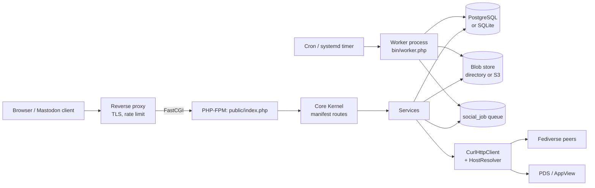
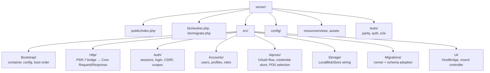
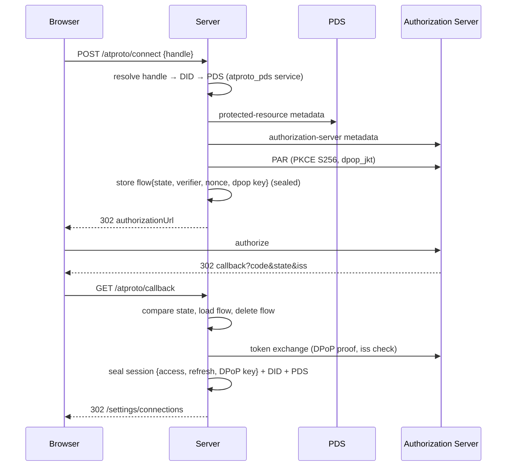
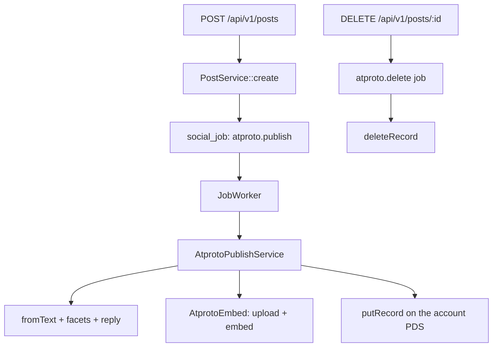

# The standalone server: build blueprint

`AlohaSocial/server` is the host that turns this library into a running
instance: accounts, sessions, HTTP entry point, migrations, worker and the
shared UI mount. This document is the specification that repository is built
against. It does not describe code in this repository, and nothing here belongs
in `src/`.

Related: [using the core from a host](host-integration.md),
[standalone host checklist](../operations/standalone-host.md),
[ADR 0006](../adr/0006-host-owned-accounts.md) (accounts are host-owned) and
[ADR 0001](../adr/0001-shared-core-two-hosts.md).

## 1. Shape of the server

One PHP codebase, two processes, one database, one blob store. No framework, no
ORM, no second HTTP stack: the server boots `Application::forHost()` and serves
the core's route manifest.

Two processes only: `public/index.php` under PHP-FPM, and a worker loop that
calls `JobWorker::runOnce()`. Sessions, rate limits and TLS live in the proxy
and in the auth layer, not in the core.

## 2. Repository layout

A host class may import `AlohaSocial\Core\*`; the core never imports
`Server\*`. Keep the bridge (`src/Ui`) the only place that knows both the UI
package and the account model.

## 3. Boot order

`src/Bootstrap/ApplicationFactory.php` runs exactly this sequence; a failure at
any step stops the boot instead of serving a half-working instance.

1. **Config** — read `config/*.php` plus environment overrides into
   `ArrayConfig`/the host's `Config`. Validate required keys at boot and fail
   with a readable message, never at the first request.
2. **Database** — PDO connection (`pdo_pgsql` preferred, `pdo_sqlite` for small
   installs), wrapped in `PdoConnection`. One connection per process; the
   worker uses its own.
3. **Clock and ids** — `SystemClock`, the host's id generator.
4. **Instance keys** — load or create the RSA key pair; seal the private key at
   rest with `Security\OpenSslSecretBox`. The key id must equal the actor id the
   core publishes; never generate it per request.
5. **HTTP client** — `CurlHttpClient` with timeout, user agent and a
   `DnsHostResolver`; wrap in `BoundedHttpClient` when remote media is enabled.
   The same client is used for federation, AT Protocol and media fetches.
6. **Repositories** — the PDO repositories the exposed features need (the full
   list is in the [standalone host checklist](../operations/standalone-host.md)).
7. **Queue and log** — `PdoJobQueue` and `PdoActivityLog` over the same
   connection.
8. **Assembly** — call `Application::forHost(...)` with the ports above and the
   host's `LocalActorDirectory`, AT Protocol account resolver/publisher/DPoP
   provider. It returns `$app` with the kernel, routes, worker, queue and
   services.
9. **Serve or work** — `index.php` maps the PSR-7 request to
   `Core\Http\Request`, calls `$app->kernel->handle()` and maps the response;
   `bin/worker.php` loops on `$app->worker->runOnce()`.

## 4. Configuration

The core reads `social/*` and `mastodon/*` keys; the server owns everything
else. Minimum viable set:

| Key | Example | Meaning |
| --- | --- | --- |
| `social/instance.url` | `https://social.example` | Public origin; all actor ids and WebFinger URLs derive from it |
| `social/instance.name` | `Aloha Social` | Display name |
| `social/instance.description` | … | Instance description |
| `social/instance.contact` | `admin@example` | Contact account id, optional |
| `social/media.remote_fetch` | `true` | Enables guarded remote-media ingestion |
| `mastodon.prefix` | `/api/mastodon` | Compatibility prefix; must not collide with `/api/v1` |
| `atproto.publish` | `true` | Enables AT Protocol publishing, profiles and interactions |
| `atproto.oauth.client_id` | `https://social.example/atproto/client-metadata.json` | OAuth client id for the PDS |
| `atproto.oauth.redirect_uri` | `https://social.example/atproto/callback` | Exact callback; must match the client metadata |
| `atproto.pds.default` | `https://bsky.social` | Fallback PDS before the DID document answers |

Secrets (database password, key-encryption key, OAuth client secret if the
server uses one) come from the environment or a secret file, never from a
committed config file. Do not log them and do not expose them through the
instance endpoint.

## 5. Database and migrations

The core owns the table definitions as `*Schema` classes; the server owns the
runner. A minimal runner:

- one `schema_migration` table (`version`, `applied_at`, `checksum`);
- each migration is a PHP class with `up(Connection)` and `down(Connection)`;
- run inside a transaction where the driver allows DDL transactions
  (PostgreSQL yes, MySQL no — accept the documented limitation);
- the first migration executes the core schema classes
  (`PostSchema`, `PollSchema`, …, `AtprotoPublicationSchema`,
  `AtprotoInboundSchema`, `JobSchema`, `ActivityLogSchema`), so a fresh install
  and an upgrade converge;
- refuse to start if an applied migration's checksum changed.

Additive columns follow the same rule as the Nextcloud host: the core document
is the source, and a host migration copies it. Nothing in the core is
auto-created at runtime.

## 6. Identity, sessions and scopes

Per [ADR 0006](../adr/0006-host-owned-accounts.md) the core receives only
`Request::$userId` and (for the compatibility routes) `Request::$scopes`. The
server therefore owns:

- `user` (id, handle, email, password hash, role, created_at, disabled_at),
- `session` (id hash, user id, CSRF token, expiry, user agent, IP hash),
- password reset tokens and email delivery,
- API tokens with scopes for the Mastodon subset,
- the `LocalActorDirectory` adapter over `user`,
- the admin flag and every admin route.

Session cookies are `HttpOnly`, `Secure`, `SameSite=Lax`; rotating the session
id on login; CSRF token checked on every state-changing route; login and
password reset rate-limited in the proxy or the auth layer. The server must not
add a role check inside `src/` of the core.

## 7. AT Protocol account linking

This is the part the core deliberately leaves open. It is a host flow with a
protocol client imported from `AlohaSocial\Core\Protocol\Atproto`.

Required host behaviour:

1. **State** is single-use, server-side and bound to the browser session; the
   callback compares it, then deletes it before the exchange.
2. **The verifier and DPoP key never reach the browser.** The ES256 key stays
   inside the sealed flow and later the sealed session.
3. **Credentials at rest** are sealed with `OpenSslSecretBox` (or a KMS-backed
   `SecretBox`), keyed by an environment secret. Store `did`, `handle`, `pds`,
   access/refresh token, expiry and the DPoP key. No token in logs, cookies or
   HTML.
4. **Refresh is serialized.** A refresh rotates the token pair; two concurrent
   requests must not both refresh. Use `SELECT … FOR UPDATE` on the account row
   (or a per-account advisory lock), refresh once, store, release. The core's
   `AtprotoSessionService` refreshes inside the 60-second leeway; the host
   supplies the store and the lock.
5. **PDS selection** — resolve the handle to a DID, read the DID document and
   take the `#atproto_pds` service `serviceEndpoint`. Persist it with the
   session; never derive it from the handle again on every request. Fall back to
   `atproto.pds.default` only when the DID document has no PDS entry.
6. **Account resolver** — `AtprotoAccountResolver::resolve($localUserId)` returns
   an `AtprotoAccount` with a fresh access token (`AtprotoSessionService`) and
   the stored PDS URL; `null` when the user has no connection.
7. **DPoP** — pass `Es256DpopProofProvider` as `atprotoDpop` so every write,
   upload and read is DPoP-bound when the session was issued that way.

Endpoints the server owns: `GET /atproto/client-metadata.json` (public),
`POST /atproto/connect`, `GET /atproto/callback`, `POST /atproto/disconnect`
(revokes and deletes the sealed session), plus a settings page that lists the
connection.

## 8. Publishing, profiles and interactions

The server does not build AT Protocol records itself; it calls the core.

- Media bytes come from the host's `BlobStore`; convert to `AtprotoMedia`
  (mime type, bytes, alt, optional dimensions) and pass them to
  `AtprotoPublishService::publish($userId, $postId, $media)`. The host never
  uploads blobs itself.
- Profile: `$app->atprotoProfiles->publish($userId, new AtprotoProfile(...))`
  from the account settings page; `remove()` when the user disconnects the
  profile.
- Likes and reposts: `$app->atprotoInteractions->like()/unlike()` and
  `repost()/undoRepost()` from the favourite/boost handlers **after** the local
  row is committed. The local action must not fail because the remote mirror
  failed; log the stable reason and keep the local state.
- Timeline: `$app->atprotoTimeline->getTimeline($account, $limit, $cursor)`.
  Map `author.did` to a local user when the DID is linked, otherwise render a
  read-only external author; cache the page if needed. A failure is shown as a
  temporary error, never as an empty timeline.

## 9. Worker and scheduler

- `bin/worker.php`: `while (true) { $app->worker->runOnce(); usleep(500_000); }`
  under systemd with restart-on-failure; SIGTERM finishes the current job.
- cron alternative: `* * * * * php /srv/aloha/bin/worker.php --once`.
- Enqueue `JobType::CLEANUP` once per day with the retention values; the core
  runs the bounded pass.
- terminal job errors are dead-lettered by the core; expose queue counts and
  dead letters on an admin page or a metrics endpoint.

## 10. Security checklist

- TLS terminated at the proxy; HSTS; secure cookies; no debug mode in
  production (`debug: false`).
- Private keys and AT Protocol tokens sealed at rest, encryption key outside
  the database and the repository.
- No request bodies, private keys or sealed payloads in logs.
- Federation and media fetches go through `CurlHttpClient` + `DnsHostResolver`
  (and `BoundedHttpClient` for remote media) — never a bare `file_get_contents`.
- CSRF on every mutating form; scoped bearer tokens for the Mastodon subset;
  admin routes behind a role check in the host.
- The instance key pair is backed up; rotating it changes the actor key id and
  must be a deliberate, documented operation.
- Database and blob store are backed up together; a restore is tested before
  the instance is announced.

## 11. Build order

Each phase ends with a check that can fail.

| Phase | Deliverable | Check |
| --- | --- | --- |
| 0 | Repository, `composer.json` with the core as a VCS dependency, `public/index.php` returning a health response | `composer check` green in the host; health route answers |
| 1 | Config, PDO, migrations runner, schema classes applied | fresh install creates every table; second run is a no-op |
| 2 | Accounts, sessions, login, CSRF, `LocalActorDirectory` | login/logout, session rotation, CSRF rejection |
| 3 | Core assembly and route parity | registered routes equal `bin/export-routes`; one post write/read over HTTP |
| 4 | Instance keys, actor document, WebFinger, inbox/outbox | a remote peer fetches the actor and delivers a signed `Create` |
| 5 | AT Protocol linking (OAuth, sealed session, PDS selection) | a real Bluesky account connects, refresh works, disconnect revokes |
| 6 | Publishing, media, worker, delete | a real post with an image appears in Bluesky and is removed again |
| 7 | Profile, likes/reposts, AppView timeline | profile visible, like/repost visible, home timeline renders |
| 8 | Shared UI bridge and mount, admin pages | login → timeline → compose → profile in the browser |
| 9 | Deployment: systemd/cron, backup, monitoring | restore from backup on a clean host |

Phases 0–3 are the "server exists" milestone (M4 in the
[roadmap](../roadmap.md)); phase 6 is the end-to-end proof. Do not announce an
instance before phase 6 passes with a real account.

## 12. What the server must not do

- Copy `src/` into the host, or fork a service "just for the server".
- Add a framework, ORM or second HTTP stack to the core's requirements.
- Build AT Protocol records or XRPC requests itself instead of calling the
  core's services and ports.
- Store tokens in plaintext, in cookies, in HTML or in logs.
- Serve the core's routes through a second implementation; the manifest is the
  contract.
