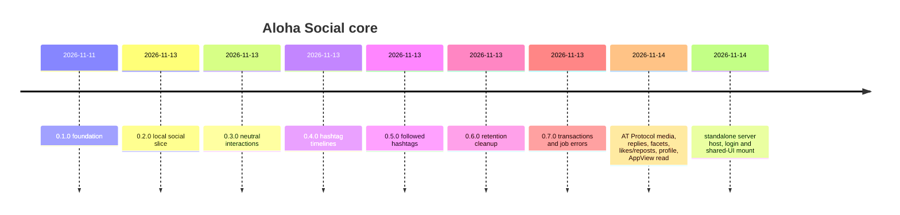

# Roadmap

Status of the core, not a promise about dates. Last reviewed: 2026-11-14.

This is the canonical status document. The guides explain how a part works;
this page says what exists, what is next and which repository owns it. If a
guide and this page disagree, the route manifest, the schemas and the tests
win — and the disagreement is a documentation bug.



## Goal

`alohasocial/core` is the host-neutral core of Aloha Social: domain, services,
federation protocol, HTTP contract, platform ports and the shared Vue package
`@alohasocial/ui`. The product is three artifacts and one behaviour:

```
                    alohasocial/core (this repository)
                    domain · services · protocols · contract
                       │                          │
        AlohaSocial/social                AlohaSocial/server
        Nextcloud host                    standalone host
        (OCP adapters, NC pages)          (kernel, auth, installer)
```

A slice is not done because a route exists. It is done when the import, the
identity checks, the contract tests and a real peer smoke test have passed in
the host that serves it. See
[ADR 0004](adr/0004-incremental-migration-and-ownership.md).

### Definition of done for the product

1. Both hosts serve exactly [`Routes::manifest()`](../src/Contract/Routes.php)
   and the same JSON error shape; a parity test compares their registered
   routes with `bin/export-routes`.
2. The Nextcloud app runs the migrated slices on the core without changing
   actor URLs, key ids, note URLs, `Create`/`Delete`/`Follow`/`Undo` activity
   ids or outgoing follow row ids, and can roll back one account by flag.
3. `AlohaSocial/server` installs from scratch and publishes a post through the
   same objects the core tests, with its own accounts, sessions and worker.
4. The shared screens run in both hosts through one `HostBridge` each, and the
   host smoke tests (login, one read, one write, logout) pass.
5. Mastodon compatibility and AT Protocol remain additive, bounded and
   disabled by default where documented; no host-specific branch appears in
   `src/`.

## Where we are (2026-11-14)

| Measure | Value |
| --- | --- |
| HTTP contract | 123 routes, 53 of them under the Mastodon prefix |
| Persistence | 25 schema classes, in-memory and PDO adapters behind shared contract tests |
| Tests | 173 PHP test files (1572 tests, 8126 assertions) and 9 UI test files (69 tests) |
| Versions | core `0.7.0` / UI `0.7.0` / HostBridge contract `1` / HTTP `v1`; the `0.7.x` pair is enforced by tests ([matrix](guides/host-integration.md#compatibility)) |
| Release | `0.7.0` (2026-11-13) is released together with `0.2.0`-`0.6.0`; `0.1.0` exists only as a CHANGELOG entry; neither Packagist nor npm has a published package yet ([artifacts](operations/release.md)) |
| Local feature slice | complete for the scope described below |
| Hosts | Nextcloud adapter not started; the standalone host lives in [SchBenedikt/server](https://github.com/SchBenedikt/server) |

### Implemented in the core

- **Posts and timelines** — create, read, edit (author-only, optimistic
  revision, stored revision history and outbound ActivityPub `Update`),
  soft-delete, visibility, replies,
  local direct posts with `recipient_ids`, public, follow-based home, hashtag
  and private followed-hashtag timelines with stable cursors, blocks, mutes,
  exclusive lists and boosts. Durable scheduled posts wait for a queued
  publication job, keep their reserved post id and publish once under
  competing workers. See
  [posts and timelines](guides/posts-and-timelines.md).
- **Social interactions** — local favourites, private bookmarks, local mutes,
  private account lists and list timelines, notifications (favourite, follow,
  mention, reblog) with dismiss/unread state, polls with local voting and
  imported remote Questions, local
  follow/unfollow and relationship reads, plus federated `Like` and
  `EmojiReact` on remote posts with their `Undo` and inbound reaction counts.
  Mastodon-shaped interaction routes live under the optional compatibility
  prefix; the remote reaction routes live under `/api/v1`. See
  [Mastodon-compatible API](guides/mastodon-api.md) and the
  [route reference](reference/routes.md#remote-reactions).
- **Quote posts and FEP-044f authorization** — a local quote of a public or
  unlisted local post is accepted synchronously with a stable authorization
  document; a quote of a remote post starts pending and delivers a
  QuoteRequest. Accept/Reject updates the stored quote, the quoted author can
  revoke, and the authorization route refuses a withdrawn or now-private
  target. Inbound QuoteRequests are answered by policy; only public/unlisted
  targets are granted. A private, deleted or revoked target renders as a null
  preview instead of leaking the original, and the Mastodon projection carries
  the state plus the nested quoted status when it is visible.
- **Remote Question polling** — an ActivityPub `Question` is imported with
  its `oneOf`/`anyOf` options, counts, schedule and `closed` marker into a
  separate remote-poll store. A local vote is stored optimistically, answered
  with the viewer's own choices and delivery state, and queued as one signed
  `Create(Note)` per choice to the author's inbox. Signed votes on local polls
  are recorded idempotently after checking the poll, the option title and the
  actor; a scheduled job marks an imported poll closed at its end time.
- **Typed remote objects** — `Article`, `Page`, `Event`, `Question`, `Audio`
  and `Video` are stored with their bounded metadata (title, event schedule,
  place, participation link, status, duration, thumbnail and keyed sources)
  for both inbox delivery and outbox backfill. Media-only objects need no
  body, titles are stripped of HTML, event dates and every URL are validated,
  and an edit or boost keeps the type and metadata.
- **Reader-side keyword filters** — private `hide`/`warn` rules with contexts,
  whole-word matching, expiry and Unicode-safe matching across post text,
  content warnings, poll options and media descriptions; warnings redact until
  the reader explicitly asks for the content. CRUD is exposed under both the
  neutral and the Mastodon v2 filter routes.
- **Follow graph and federation** — incoming and outgoing edges, individual
  and shared inboxes, batched delivery, optional follow policy, local-to-local
  follows, signed `Follow`/`Undo`, inbound `Follow`/`Undo`/`Create`/`Delete`/
  `Announce`, outbound `Block`/`Undo(Block)` and local `Announce`/
  `Undo(Announce)`, retries with backoff, dead letters and a durable replay
  log. See [federation](guides/federation.md),
  [inbound federation](guides/inbound-federation.md) and
  [jobs and delivery](guides/jobs-and-delivery.md).
- **Discovery** — actor document, WebFinger, followers/following/outbox
  collections with bounded pages. See [peer discovery](guides/peer-discovery.md).
- **Remote content** — stored remote posts and boosts, guarded remote media,
  bounded outbox backfill and on-demand thread/context fetching with an
  idempotent object cache. See [remote threads](guides/remote-threads.md) and
  [remote backfill](guides/remote-backfill.md).
- **Media** — JPEG/PNG/WebP validation, untouched originals, GD thumbnails,
  authenticated upload, public fetch, post attachments, ActivityStreams
  `attachment` entries on the `Create(Note)` that delivery and the outbox send,
  and SSRF-safe remote ingestion. See [media](guides/media.md).
- **Operations** — the `cleanup` worker job and `CleanupService` remove
  unreferenced media, read notifications and thread-cache rows after a
  configurable retention. Runs are dry-runnable, per-kind bounded and
  idempotent; linked media, fresh rows and unread notifications are never
  touched. See [retention cleanup](guides/retention-cleanup.md). Post writes
  and deletes, including their side rows and delivery jobs, are atomic through
  `Platform\Db\TransactionRunner`; terminal job errors are dead-lettered
  immediately and a failed completion is logged rather than retried. See
  [jobs and delivery](guides/jobs-and-delivery.md).
- **AT Protocol** — public text-only publishing through bearer or DPoP-bound
  XRPC `putRecord`/`deleteRecord`, deterministic TIDs, byte-offset tag/mention/link
  facets, reply references with a `getRecord` CID lookup, image/video blob uploads
  with `app.bsky.embed.images`/`#video` embeds, likes and reposts as
  `app.bsky.feed.like`/`#.repost` records, the `app.bsky.actor.profile` record
  with avatar/banner blobs, an `app.bsky.feed.getTimeline` read port,
  idempotent publication rows, a read
  of the stored publication state, remote delete, OAuth session refresh
  and the authorization-code/PAR/revocation protocol client. Account linking
  UI, credential storage and PDS selection stay with the host. See
  [AT Protocol publishing](guides/atproto.md) and
  [two protocols, one model](guides/dual-protocol.md).
- **Mastodon compatibility** — 44 local routes behind a configurable,
  disabled-by-default prefix: instance metadata/statistics, public and list
  timelines, status read/create/delete, reblogs, context, polls, favourites,
  bookmarks, mutes, lists, notifications, local search, media management,
  account profiles, follower/following lists and verify credentials.
- **HTTP contract** — one route manifest, generic kernel, one error shape,
  OpenAPI 3.1 export and stable error codes. See [routes](reference/routes.md).
- **Persistence and migration** — schema classes for every core table,
  in-memory and PDO repositories behind shared contract tests, durable
  `PdoJobQueue`/`PdoActivityLog`, `Application::forHost()`, the neutral cutover
  export and the read-only validator. See [database](guides/database.md) and
  [migrating a Nextcloud installation](guides/migration-from-nextcloud.md).
- **Local interaction API** — `GET /api/v1/accounts/{id}` returns a public
  local profile with the viewer relationship; `POST`/`DELETE
  /api/v1/accounts/{id}/follow` write the local edge idempotently;
  `GET /api/v1/notifications` pages unread visible events with the unread
  count; sender-category policy and held requests configure delivery, the
  conversation mute suppresses one thread's alerts, and
  `POST .../notifications/{id}/dismiss`, `.../notifications/clear` and
  `GET .../notifications/unread_count` manage the read marker. These are
  neutral routes, not the Mastodon-shaped projection, and reuse the existing
  follow graph and notification table.
- **Shared UI** — `@alohasocial/ui` with the typed `HostBridge`, Vue plugin,
  typed `CoreApi`, network-free `FakeHostBridge`, `PostCard`, read-only
  `PublicTimeline` (public or hashtag timeline), `PostDetail`, and the write
  screens `ActorHeader` (follow control), `PostComposer` and
  `NotificationList` (dismiss, clear, paging).
  See [shared UI](guides/shared-ui.md).
- **Version compatibility** — `Version::CURRENT` and `ui/package.json` are the
  two package authorities; the UI lockfile and TypeScript constants are
  checked against them, and HostBridge contract `1` is checked at
  `createAlohaUi()` with an optional, backward-compatible field. See the
  [compatibility matrix](guides/host-integration.md#compatibility).

### Not in this repository

- The Nextcloud adapter, mount pages, admin settings and the data import.
- The standalone bootstrap, accounts, sessions, roles and administrator
  checks (host-owned per [ADR 0006](adr/0006-host-owned-accounts.md)),
  installer, container and migration runner. These exist in
  [SchBenedikt/server](https://github.com/SchBenedikt/server), not here.
- The host bridges and mount pages that render the shared screens inside the
  Nextcloud page and the standalone server.
- The external remainder of the Mastodon server API and of the AT Protocol
  stack.
- An object-storage adapter such as S3; the core ships memory and local stores
  behind `BlobStore`.

## Milestones

State legend: **done** — shipped and tested; **partial** — a documented slice
exists; **open** — not started; **external** — depends on a host, a remote
server or a product decision.

| # | Milestone | State | Owner | Exit criterion |
| --- | --- | --- | --- | --- |
| M0 | Core foundation | done (`0.1.0`) | core | Ports, posts, HTTP signatures, delivery queue, kernel and boundary guard are green |
| M1 | Local social slice | done | core | The local post/follow/media/interaction surface is complete, disabled-by-default compatibility surfaces included |
| M2 | Release and documentation consistency | done (`0.2.0`-`0.7.0` released; registry publication pending) | core | `composer check` green, documentation matches the manifest, `0.2.0`-`0.7.0` released |
| M3 | Nextcloud host cutover | open | `social` | Adapters, bridge, import, shadow run, validator `PASS`, one account cut over and rolled back by flag |
| M4 | Standalone host | partial | `server` | Fresh install with its own accounts, sessions and roles (host-owned, accepted ADR 0006), worker and installer publishes a post and federates; built against the [server blueprint](guides/server-architecture.md). The PHP host, its migrations, worker, login, `/app` mount and standalone `HostBridge` exist in [SchBenedikt/server](https://github.com/SchBenedikt/server); installer hardening, deployment and a real-peer QA pass remain |
| M5a | Host-neutral interaction API and shared write screens | done | core / `ui` | Profile/follow, notification and composer routes plus the three screens are tested end to end |
| M5 | Shared UI rollout | partial | `ui` + hosts | The standalone bridge and `/app` mount exist in [SchBenedikt/server](https://github.com/SchBenedikt/server); the Nextcloud bridge and mount page, and the host smoke tests in both hosts, remain |
| M6 | Compatibility remainder | partial / external | core + hosts | The external remainder is either implemented by a host or explicitly not planned |
| M7 | Operations and packaging | partial | `server` / ops | Installer, worker and container exist in [SchBenedikt/server](https://github.com/SchBenedikt/server); backup, monitoring and an object-storage option remain, and the core cleanup job is already available |

## Now (core)

1. **Keep the contract documentation honest.** `DocumentationTest` compares
   `docs/reference/routes.md` with `Routes::manifest()`, checks the advertised
   counts in the README and this page, verifies that every `*Schema` class
   appears in the database guide and that every configuration key the core reads
   appears in the [configuration reference](reference/configuration.md).
2. **Publish the registries.** `0.7.0` is cut and tagged; Packagist and the npm
   registry still need maintainer credentials. A host should be able to install
   a version instead of `dev-main`.
3. **Keep the settled identity boundary.** [ADR 0006](adr/0006-host-owned-accounts.md)
   is accepted: accounts, sessions, credentials, roles and instance-admin
   rights stay host-owned. Any new account or permission feature goes to the
   host; the core keeps `Request::$userId`/scopes and adds no user table or
   `Platform\Identity` port. The standalone implements auth itself and passes
   `userId` as every host does.
4. **Mount the finished shared screens in the hosts.** `ActorHeader`,
   `PostComposer` and `NotificationList` are complete and covered by
   `FakeHostBridge` tests. The standalone `HostBridge` and its `/app` mount are
   in [SchBenedikt/server](https://github.com/SchBenedikt/server); the Nextcloud
   bridge and mount page remain. Neither belongs in this repository: do not
   move a Nextcloud-only page into the package.

## Next

| Item | Seam | Owner | Done when |
| --- | --- | --- | --- |
| Nextcloud OCP adapters, controller and route registration | `social` | `social` | Registered routes equal `bin/export-routes`; the host parity test is green |
| Nextcloud `HostBridge`, mount pages and navigation | `social` | `social` | `PublicTimeline` and `PostDetail` render against the real bridge; login, 401 and logout work |
| Nextcloud posts/follows import and actor-URL parity | `social` | `social` | The neutral export passes `bin/validate-cutover`; counts and checksums match the source |
| Cutover: posts/timelines → actor surface → follows/delivery → inbox → UI | `social` | `social` | One account runs end to end on the core and a flag restores the old path |
| Standalone deployment and QA | [server installation](https://github.com/SchBenedikt/server/blob/main/docs/installation.md) + [blueprint](guides/server-architecture.md) | `server` | A fresh install from the documented steps publishes a post that a real peer receives |
| Standalone AT Protocol linking (OAuth state, sealed tokens, refresh lock, PDS from the DID document) | `server` + [blueprint](guides/server-architecture.md#7-at-protocol-account-linking) | `server` | A real account connects, refreshes and publishes |
| Standalone installer hardening and container packaging | `server` | `server` | The installer and container images are reproducible and covered by the server's own tests |
| Mount the shared actor/follow, composer and notification screens | host bridges | `ui` + hosts | Both hosts complete one read and one write through the real bridge |
| Mastodon OAuth/token issuance and app registration | host identity service | `social` / `server` | A third-party client can authorize and call the compatibility routes |
| Registry publication: Packagist and npm | core | core | A host installs the tagged `0.7.x` release instead of `dev-main`; verified artifacts await registry credentials ([release](operations/release.md)) |

## Later

- **Locally implementable Mastodon remainder:** follow requests/locked accounts
  and the wider account-management surface. These are product decisions, not
  protocol blockers; they are not part of the local slice above.
- **AT Protocol after this publishing slice:** link cards, video transcoding and
  CAR/MST repository access.
- **Object storage:** an S3-compatible `BlobStore` adapter when a host needs it.
- **Operations:** backup/restore and monitoring for the standalone host,
  plus an S3-compatible blob store whose layout can be swept independently of
  the core metadata cleanup.
- **Admin UI:** host pages; the core keeps the settings rules.

## Explicitly not planned

- A rewrite in another language.
- A "fake Nextcloud" shim as a permanent architecture (see
  [ADR 0001](adr/0001-shared-core-two-hosts.md)).
- Storing configuration or keys in this repository.
- Remote direct delivery and remote reply threading: direct posts and replies
  address the local model only. Remote recipients/inboxes and fetching a
  remote parent are not part of this slice.
- A public block collection and applying an incoming `Block` as a per-user
  moderation rule: block propagation is outbound, and the optional instance
  policy remains the host seam for instance-wide refusal.

## Compatibility remainder

These parts are implemented by a host or need remote data; they are not hidden
local gaps. The detailed lists live in the guides.

- **Mastodon:** OAuth authorization/token issuance/revocation and app
  registration; remote timelines and delivery; remote counts for an outbound
  `Like` (the count itself lives on the remote instance); remote boost
  federation; remote notifications; streaming; remote poll
  fetching/voting/`Question` federation; remote search; remote
  relationship/admin APIs. See
  [Mastodon-compatible API](guides/mastodon-api.md#what-remains-external).
- **AT Protocol:** account-linking UI/browser callback, the short-lived flow
  store, credential storage and PDS selection; CAR/MST repository access; video
  transcoding; the firehose and incoming AppView events; link cards; migrating
  the existing Nextcloud implementation. The AppView timeline read is a core
  port; rendering it is host work. See
  [AT Protocol publishing](guides/atproto.md#remaining-external-work).
- **Hosts:** login, sessions, account creation/reset, CSRF, bearer-token
  issuance, admin settings, navigation, templates, deployment and the worker
  process. The core never issues tokens or owns a session.

## Release history

| Version | Date | Content |
| --- | --- | --- |
| `0.1.0` | 2026-11-11 | Foundation: ports, posts, timelines, ActivityPub, delivery queue, HTTP kernel, route manifest, boundary guard |
| `0.2.0` | 2026-11-13 | The local social slice: media, remote content, blocks, direct posts, interactions, Mastodon compatibility, AT Protocol foundation and publication-state read, dual-protocol guide, shared UI reads, migration validator |
| `0.3.0` | 2026-11-13 | Neutral profile/follow/notification API, shared `ActorHeader`/`PostComposer`/`NotificationList` write screens, host-level SQL coverage and release documentation |
| `0.4.0` | 2026-11-13 | Public hashtag timelines with normalized storage, cursor paging, `timelines.tag` and a tag-scoped `PublicTimeline` |
| `0.5.0` | 2026-11-13 | Private followed hashtags with SQL persistence, idempotent follow/unfollow, bounded tag pages and the `timelines.followed_tags` page |
| `0.6.0` | 2026-11-13 | Core retention cleanup job for unreferenced media, read notifications and thread caches, with dry run, per-kind limits, stable reasons and a real demo |
| `0.7.0` | 2026-11-13 | Atomic post writes through `TransactionRunner`, immediate dead letters for terminal job errors, completion-failure handling and stable worker codes |

`0.1.0` has a CHANGELOG entry but no git tag. `0.2.0`-`0.7.0` are released and
recorded in the [changelog](../CHANGELOG.md); registry publication is the
remaining M2 step.
